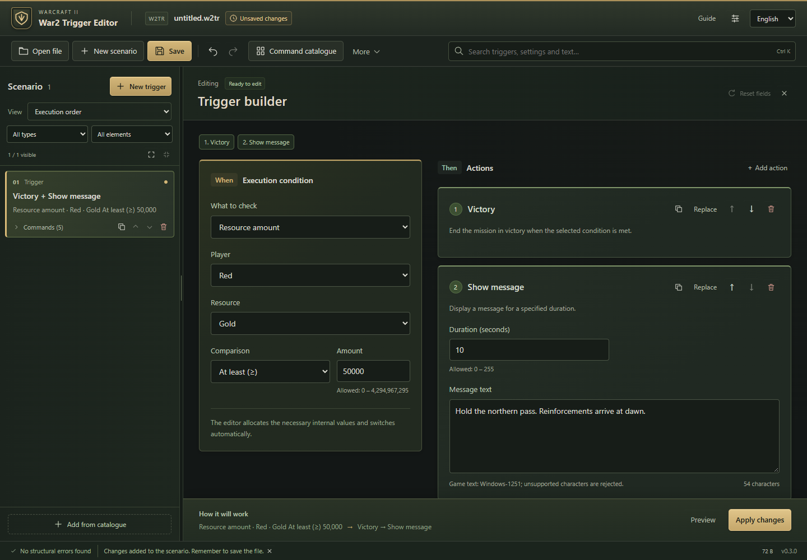
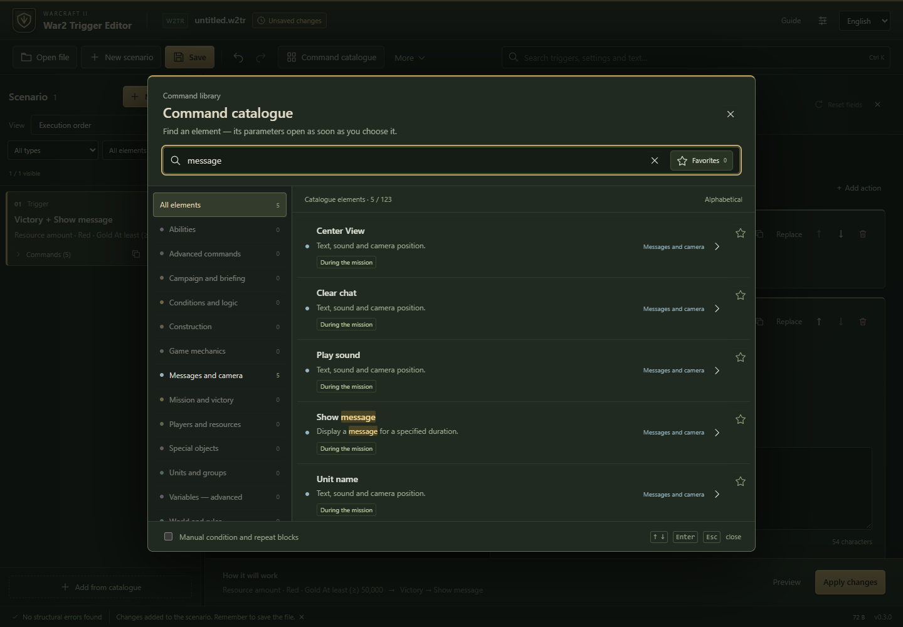
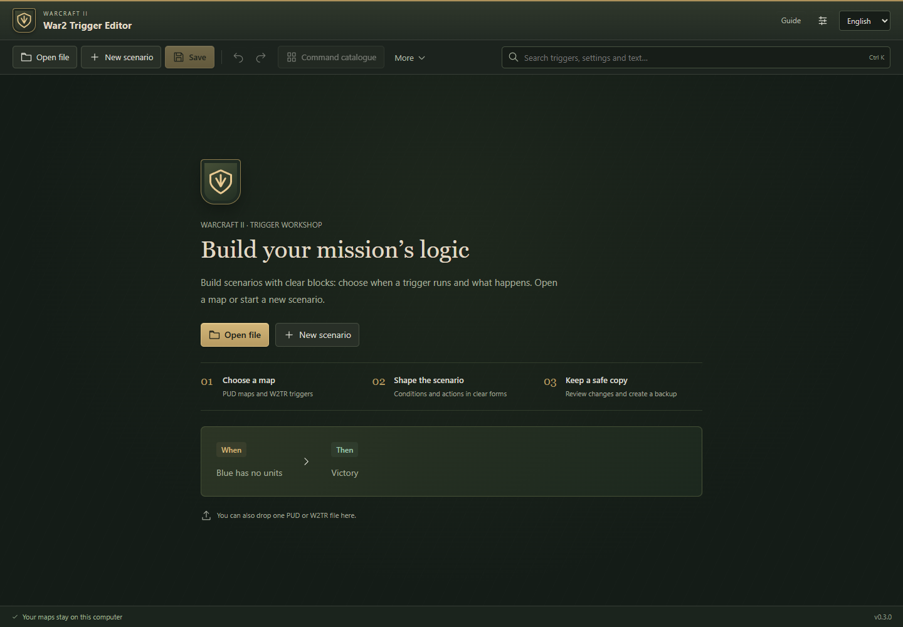

# 68 улучшений рабочего места

Изменения этого этапа добавлены поверх первого исправления надёжности.
Каждый пункт ниже реализован в коде; это перечень результата, а не план.

## Визуал и настройки

1. Обновлена верхняя панель: эмблема-щит, подпись Warcraft II и оформление металла.
2. Состояния документа оформлены отдельными плашками с пиктограммами.
3. Стартовый экран получил пошаговый маршрут «Открыть → Настроить → Сохранить».
4. Добавлен выбор обычной и компактной плотности интерфейса.
5. Добавлен масштаб текста 100%, 115% и 130%; размеры шрифтов переведены в rem.
6. Добавлен режим повышенного контраста.
7. Добавлено отключение пояснений к полям.
8. Добавлен общий сброс настроек рабочего места.
9. Настройки и язык сохраняются с обработкой недоступного хранилища.
10. Сохранённые настройки проверяются: неверные типы и значения заменяются допустимыми.

## Компоновка и доступность

11. Панель сценария меняет ширину перетаскиванием разделителя.
12. Разделитель управляется стрелками, Shift, Home и End.
13. Ширина сохраняется; двойной щелчок возвращает стандартный размер.
14. Доработана компоновка при ширине 390, 900 и 1440 пикселей и крупном тексте.
15. Категории каталога на узком экране показаны горизонтальной полосой.
16. Добавлена ссылка для перехода с клавиатуры сразу к редактору.
17. Добавлены стили системного режима forced-colors.
18. Фокус внутри редактируемого действия выделяет всю карточку.
19. Основные кнопки получили единый набор векторных пиктограмм.
20. Уведомления остаются до следующей операции или явного закрытия.

## Работа со сценарием

21. Добавлен фильтр по типу: триггеры, отдельные команды, повторы.
22. Добавлен фильтр по группе команд.
23. Показан счётчик видимых блоков относительно общего количества.
24. Добавлен сброс всех фильтров вместе с поисковым запросом.
25. Добавлены разворачивание и сворачивание всех команд.
26. Режим представления сценария сохраняется между открытиями.
27. Список сценария поддерживает стрелки, Home и End.
28. Выбранный блок автоматически прокручивается в видимую область.
29. При выборе внутренней команды выделяется её родительский блок.
30. Удаление блока требует подтверждения с количеством его команд.

## Каталог и поиск

31. Совпадения поиска подсвечиваются в названии и описании блока сценария.
32. Команды можно добавлять в избранное; список сохраняется.
33. Добавлен отдельный фильтр избранных команд и сочетание Alt+F.
34. Добавлены сохраняемые недавние команды с быстрым выбором.
35. Счётчики категорий учитывают текущий поисковый запрос.
36. Категории без совпадений недоступны, пустое избранное объясняет следующий шаг.
37. Каталог поддерживает ArrowUp, ArrowDown, Home и End.
38. Подсветка каталога безопасно обрабатывает символы регулярных выражений.
39. В карточках команд показана стадия: настройка миссии или выполнение.
40. В расширенном режиме доступны номер команды, длина и поиск по номеру.

## Конструктор и формы

41. Добавлены три редактируемых шаблона: победа, ресурсы и сообщение.
42. Добавлено дублирование действия с переносом фокуса к копии.
43. Добавлена навигация к действиям внутри длинного триггера.
44. Добавлен подтверждаемый сброс полей к состоянию открытия формы.
45. Удаление действия из черновика требует подтверждения.
46. Выбор игроков получил кнопки «Выбрать всех» и «Снять выбор».
47. Неверные числа выделяются; сохраняется нативная проверка диапазона и шага.
48. Числовые и текстовые поля связаны с пояснениями через aria-describedby.
49. Текстовые поля показывают количество символов.
50. Форма показывает отдельное состояние готовности и изменённых полей.

## Команды, файлы и надёжность

51. Ctrl+Shift+S вызывает «Сохранить как».
52. Ctrl+Z, Ctrl+Shift+Z и Ctrl+Y управляют историей, сохраняя собственную отмену текстовых полей.
53. Ctrl+Enter применяет форму с проверкой заполнения.
54. Escape очищает общий поиск и возвращает к нему фокус.
55. В справку добавлена таблица горячих клавиш.
56. Добавлено окно сведений о документе, размере, ревизии, командах и секциях PUD.
57. Для PUD добавлен индикатор заполнения области программы.
58. Диагностика устраняет дубликаты и позволяет перейти к проблемной команде.
59. Добавлены сведения о последнем сохранении и копирование путей с ручным резервным способом.
60. В окне восстановления добавлены поиск по имени и сортировка.
61. Бэкапы отсортированы от новых к старым и показывают удобный размер.
62. Синхронная блокировка не допускает повторных запросов во время операции.
63. API сообщает доступность undo/redo; кнопки отражают реальную историю.
64. Применение без изменений не создаёт новую ревизию, историю и снимок восстановления.
65. Сетевые ошибки и ответ 413 показывают соответствующее объяснение.
66. Файл PUD/W2TR можно открыть перетаскиванием с визуальной областью приёма.
67. Перетаскивание нескольких или неподдерживаемых файлов объясняет ошибку; при открытом окне импорт блокируется.
68. Размеры файлов, диапазоны и числа форматируются с учётом выбранного языка.

## Где смотреть

| Часть | Основные файлы |
|---|---|
| Настройки и сохранение | `preferences.ts`, `WorkspaceSettings.tsx` |
| Панели и управление | `ResizableWorkspace.tsx`, `useShortcuts.ts`, `AppChrome.tsx` |
| Стиль и адаптация | `workbench.css`, `theme.css`, остальные модульные стили |
| Сценарий | `Scenario.tsx`, `Highlight.tsx` |
| Каталог | `Catalog.tsx` |
| Формы | `Builder.tsx`, `CommandFields.tsx`, `ConditionFields.tsx` |
| Сведения и файлы | `DocumentInfo.tsx`, `DocumentStatus.tsx`, `FileDialogs.tsx`, `useFileDrop.ts` |
| API истории | `contracts/src/documents.rs`, `app-api/src/sessions.rs` |

## Проверка

- 23 Rust unit/integration-теста, в том числе сохранность всех 14 исходных PUD/W2TR.
- 26 браузерных сценариев в Edge: прежние 11 и 15 новых.
- Сохранение проверяется на реальном временном файле: байты бэкапа и результата сравниваются.
- Смена плотности, фильтров и ширины панели проверяется без изменения экспортируемого файла.
- Проверены RU/EN, крупный текст, клавиатура, отсутствие хранилища, неверные настройки.
- TypeScript/Vite, Windows GUI/CLI, fmt, clippy, архитектура и максимум 500 строк.
- В текущей ограниченной среде Vite использует --configLoader runner; тесты подключаются
  к отдельно запущенному war2-editor.exe --headless. Штатный CI сохраняет обычный запуск.

Игровая приёмка War2Combat/War2Mod в этот этап не входит.

## Примеры интерфейса

